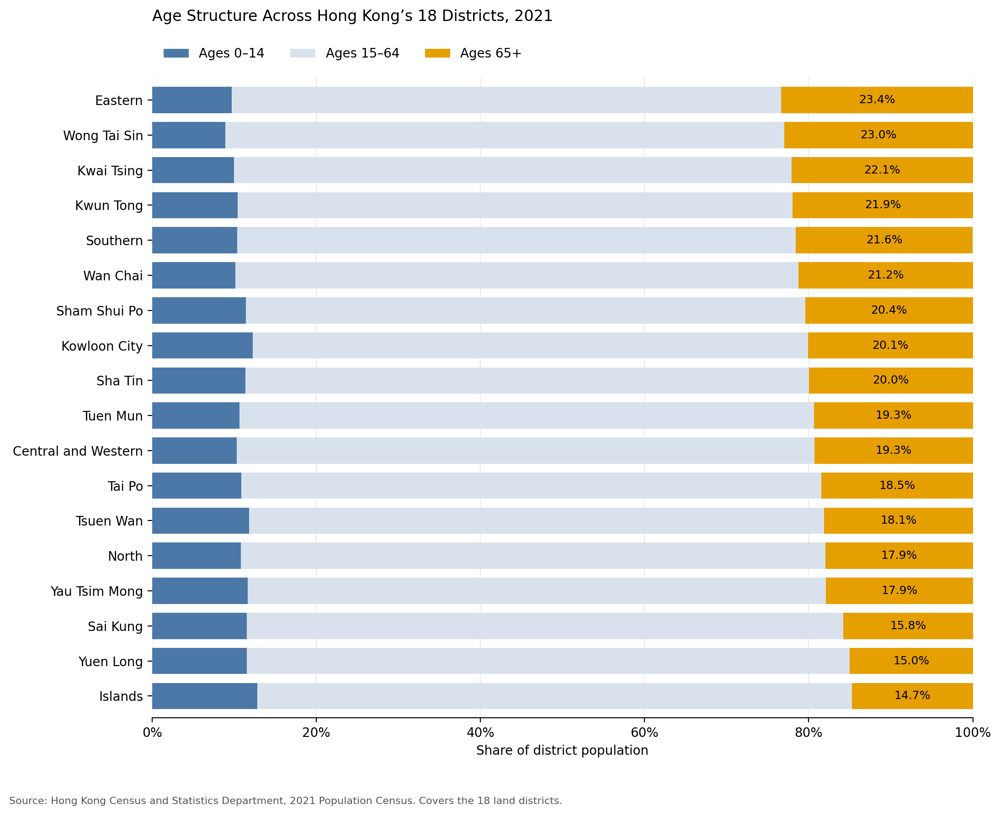

# Population Size and Age Structure Across Hong Kong’s 18 Districts

**Author:** GUO QIZHEN  
**Reference year:** 2021  
**Status:** Initial exploratory analysis completed

## Research Questions

1. How does age structure differ across Hong Kong’s 18 districts?
2. Do more populous districts also have higher proportions of residents aged 65 and over?

This project distinguishes population size from age composition using
official district-level census data.

## Dataset Source and Usage Permissions

The dataset is published by the Census and Statistics Department,
Hong Kong SAR Government:

**2021 Population Census — Statistics by District Council District**

- [Official dataset page](https://data.gov.hk/en-data/dataset/hk-censtatd-census_geo-2021-population-census-by-dcd)
- [Official CSV download package](https://www.census2021.gov.hk/doc/DC_21C.zip)
- [DATA.GOV.HK Terms and Conditions](https://data.gov.hk/en/terms-and-conditions)

The data are used under the applicable DATA.GOV.HK Terms and Conditions,
which permit use and reproduction subject to their conditions, including
source identification and attribution.

Acknowledgement: Census and Statistics Department, Hong Kong SAR
Government, and DATA.GOV.HK. Intellectual property rights in the source
data remain with the Government and any relevant rights holders.

The original CSV is retained without editing. Filtering, renaming,
numeric conversion, and percentage calculations take place in the notebook.
The analysis and figures are not official government statistical products.

The comparison covers the 18 land districts and excludes Marine residents.

## Methods and Tools

The analysis uses Python, pandas, NumPy, and Matplotlib.

Processing steps:

1. Read the fifth CSV row as the machine-readable header.
2. Select the 18 official district codes, excluding totals and notes.
3. Convert population fields to numeric values.
4. Check district uniqueness, missing values, non-negative counts,
   and agreement between age-group counts and total population.
5. Combine ages 15–24, 25–44, and 45–64 into an ages 15–64 group.
6. Calculate district age-group percentages.
7. Visualize age composition and its relationship with population size.
8. Calculate a population-weighted reference share and Pearson correlation.

## Visualizations

### Figure 1: District Age Structure



The chart compares three age groups and orders districts by the share
aged 65 and over. Eastern had the highest older-population share,
approximately 23.4%, while Islands had the lowest, approximately 14.7%.

### Figure 2: Population Size and Older-Population Share


The population-weighted share aged 65 and over across the 18 districts
was 19.58%. The district-level Pearson correlation between total
population and older-population share was 0.130, indicating a weak
positive linear association in this descriptive comparison.

## Key Findings

- Districts differed in age composition, not only population size.
- A large population did not necessarily correspond to a high
  older-population percentage.
- Population totals and percentages should be considered separately.

## Limitations

- The data describe 2021, not Hong Kong's current population structure.
- A single census year cannot establish changes over time.
- The analysis covers only 18 land districts.
- District averages hide variation within districts.
- Correlation does not establish causation or explain the demographic
  processes behind the observed differences.

## Project Structure

```text
data-science-project/
├── README.md
├── requirements.txt
├── data/
│   └── DC_21C.CSV
├── notebooks/
│   └── hong_kong_district_age_analysis.ipynb
└── figures/
    ├── figure01_district_age_structure.png
    └── figure02_population_vs_older_share.png
```

## How to Run

### 1. Obtain the project and data

Download this repository using GitHub's **Code → Download ZIP** option
and extract it, or clone the repository.

Confirm that the original file is located at `data/DC_21C.CSV`.
If it is absent, download the official CSV package linked above,
extract it, and place the CSV at that location.

Keep the filename and capitalization unchanged.

### 2. Prepare a Python environment

The analysis was run with Python 3.10.22 and the library versions
recorded in `requirements.txt`.

With Anaconda or Miniconda installed, create a separate environment:

```bash
conda create -n hk-age-portfolio python=3.10 -y
conda activate hk-age-portfolio
```

In a terminal, change into the extracted `data-science-project` root
folder. Then install the analysis dependencies and notebook interface:

```bash
python -m pip install -r requirements.txt
python -m pip install jupyterlab
python -m ipykernel install --user --name hk-age-portfolio --display-name "Python (hk-age-portfolio)"
```

### 3. Run the notebook

From the project root, launch JupyterLab:

```bash
jupyter lab
```

Open `notebooks/hong_kong_district_age_analysis.ipynb`.

Select the **Python (hk-age-portfolio)** kernel, restart the kernel,
and run all cells from top to bottom.

The notebook reads the original data, performs validation, displays
both figures, and saves the PNG files in the `figures` folder.

No API key or geoplotlib installation is required.